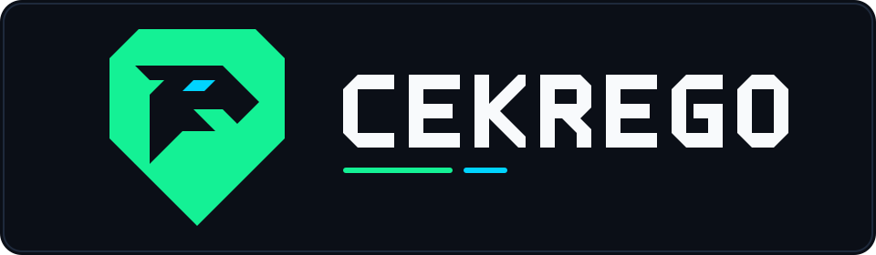

<div align="center">
  
</div>

# 🦅 CekRego Crypto Bot


**CekRego Crypto Bot** adalah bot Telegram *all-in-one* berbasis `aiogram 3.x` untuk analisis pasar kripto real-time, konversi harga multi-mata uang, pemindaian token DEX on-chain (**DexScreener**), audit keamanan kontrak pintar (**RugCheck.xyz** & **GoPlus Security**), radar kelulusan **Pump.fun ➔ Raydium**, *liquidation stream* **Binance Futures**, serta analisis teknikal & fundamental berbantuan AI (**OpenRouter / Google Gemini**).

---

## ✨ Fitur Utama

### 🛡️ 1. On-Chain DEX Radar & RugCheck Security Scanner
- **DexScreener Real-Time Card (`/dex` & Auto-Detect Contract Address)**:
  - Otomatis mendeteksi **Contract Address (Solana & EVM)** yang di-*paste* langsung di grup atau *private chat* tanpa perlu mengetik command.
  - Menampilkan harga real-time, *Market Cap*, *FDV*, *Liquidity*, perubahan harga (`5m`, `1h`, `6h`, `24h`), volume & rasio transaksi *Buy/Sell*, serta *Smart Risk Warnings*.
  - Tombol cepat ke **DexScreener**, **Photon**, **BullX**, **Uniswap**, **PancakeSwap**, serta *chain/pair switcher*.
- **Smart Contract & RugCheck Scanner (`/rug`, `/rugcheck`, `/scan`, `/audit`)**:
  - **Solana (`RugCheck.xyz`)**: Menampilkan *Normalized Risk Score* (`0–100`), status *Mint Authority* & *Freeze Authority*, *Mutable Metadata*, persentase *LP Locked/Burned*, deteksi *Insider Networks*, *Creator Balance*, serta distribusi **Top 10 Holders (Non-LP)** dan **Top 5 Wallets** (otomatis memfilter pool AMM/Raydium/Locker).
  - **EVM (`GoPlus Security`)**: Mendukung Ethereum, BSC, Base, Arbitrum, Polygon, Optimism, Avalanche, Blast, dan Fantom. Mengecek *Honeypot*, *Open Source Verification*, *Buy/Sell Tax*, *Ownership Renounced*, *Mintable/Proxy*, dan **Top 10 Holders (Non-LP)**.

### 🎓 2. Pump.fun ➔ Raydium Graduation Radar
- Memantau *stream* WebSocket `pumpportal.fun` secara real-time 24/7.
- Setiap kali koin meme baru lulus (*graduated*) dari *bonding curve* Pump.fun ke Raydium, bot otomatis memindai data pasar + **RugCheck Audit** dan mempublikasikan kartu sinyal ke channel target (`ALPHA_CHANNEL`) serta menyimpannya untuk diakses via `/graduated` (`/alpha`).

### 🧠 3. AI Market Intelligence & Quant Signals
- **AI Technical + Fundamental Signal (`/ai <coin>`)**: Menggabungkan indikator teknikal (`RSI`, `EMA`, `MACD`, `Bollinger Bands`, `ATR`, `Support/Resistance`) dengan berita fundamental terbaru untuk menghasilkan *setup* `LONG / SHORT / WAIT`, *Entry*, *Take Profit*, *Stop Loss*, *Risk Score*, dan *Confidence*.
- **Live Quant Signals (`/signals` / `/x70`)**: Menampilkan sinyal kuantitatif langsung dari `signals.x70.ai` beserta analisis *Whale Flow* dan *Orderbook Imbalance*.
- **Grounded AI Research (`/news`, `/thesis`, `/calendar`, `/ask`)**:
  - `/news <coin>`: Ringkasan berita terbaru beserta sentimen *Bullish/Bearish*.
  - `/thesis <coin>`: Bull case, bear case, katalis, dan *key metrics* koin.
  - `/calendar [days]`: Kalender agenda makro & kripto mendatang dalam zona waktu `UTC` dan `WIB (UTC+7)`.
  - `/ask <pertanyaan>`: Tanya jawab interaktif seputar kripto/makro dengan dukungan *multi-turn reply thread*.

### 💹 4. Market Data, Konversi & Utilitas Cepat
- **Cek Harga & Konversi Instan (`/p`, `1 btc`, `50rb idr sol`, `100 usd idr`)**: Mendukung ratusan mata uang fiat dan ribuan aset kripto via CoinGecko + Open ER-API.
- **Candlestick / Price Chart (`/c <coin> [1|7|30]`)**: Merender grafik harga visual langsung di Telegram.
- **Binance Futures Liquidation Stream (`/liq [coin]`)**: Memantau likuidasi posisi *Long* & *Short* secara real-time via WebSocket Binance Futures.
- **Market Listing Explorer (`/market <coin>`)**: Melihat daftar bursa CEX dan DEX tempat suatu koin diperdagangkan beserta volumenya.
- **Trending & Top Movers (`/trend`, `/gnr`, `/lsr`)**: Memantau koin paling *trending*, *Top Gainers*, dan *Top Losers* 24 jam terakhir.
- **Kalkulator Aman & Konverter Waktu (`/calc`, `100*25/4`, `20:00 UTC`)**: Evaluasi ekspresi matematika aman berbasis AST dan konversi jam `UTC` ke `WIB` otomatis.

---

## 📂 Struktur Proyek

```text
├── main.py                 # Entrypoint utama bot, background workers & scheduler
├── config.py               # Konfigurasi environment variables (.env)
├── requirements.txt        # Daftar dependensi Python
├── .env.example            # Template konfigurasi environment
└── bot/
    ├── database/           # SQLite async layer (aiosqlite)
    │   ├── db.py           # Inisialisasi skema tabel & migrasi
    │   └── models.py       # Query helper (subscribers, analytics, market_feed)
    ├── handlers/           # Aiogram 3.x message & callback routers
    │   ├── market_handlers.py  # Harga, konversi, chart, /dex, /rug, /graduated
    │   ├── ai_handlers.py      # /ai, /ask, /signals (/x70)
    │   ├── news_handlers.py    # /liq, /news, /thesis, /calendar
    │   ├── utility_handlers.py # Kalkulator AST & konversi waktu UTC->WIB
    │   └── admin_handlers.py   # Inline mode & analytics admin
    ├── services/           # Integrasi API eksternal & background scanners
    │   ├── coingecko.py        # CoinGecko API + caching & chart generator
    │   ├── dexscreener.py      # DexScreener API client
    │   ├── rugcheck.py         # RugCheck.xyz (Solana) & GoPlus Security (EVM)
    │   ├── pump_scanner.py     # PumpPortal WebSocket graduation scanner
    │   ├── binance_ws.py       # Binance Futures forceOrder WebSocket collector
    │   ├── gemini_ai.py        # OpenRouter & Google Gemini AI engine
    │   ├── x70_signals.py      # signals.x70.ai quant signals client
    │   ├── telethon_feed.py    # Optional Telethon marketfeed collector
    │   └── http_session.py     # Shared aiohttp ClientSession pool
    └── utils/              # Formatter teks, parser angka, rate limiter, indikator TA
```

---

## 🚀 Cara Instalasi & Menjalankan Bot

### 1. Clone Repository
```bash
git clone https://github.com/nialthony/cekrego-crypto-bot.git
cd cekrego-crypto-bot
```

### 2. Buat Virtual Environment & Install Dependensi
```bash
python -m venv venv
# Windows (PowerShell):
.\venv\Scripts\Activate.ps1
# Linux / macOS:
source venv/bin/activate

pip install -r requirements.txt
```

### 3. Konfigurasi File `.env`
Salin `.env.example` menjadi `.env` lalu isi token dan API key milikmu:
```bash
cp .env.example .env
```

Minimal variabel yang wajib diisi di `.env`:
- `TELEGRAM_API_TOKEN`: Token bot dari [@BotFather](https://t.me/BotFather)
- `ADMIN_USER_ID`: ID Telegram numerik kamu
- `COINGECKO_API_KEY`: API key dari [CoinGecko Developer Dashboard](https://www.coingecko.com/en/developers/dashboard)
- `OPENROUTER_API_KEY` atau `GEMINI_API_KEY`: Untuk fitur AI (`/ai`, `/ask`, `/news`, `/thesis`, `/calendar`)

*(Fitur `/dex`, `/rug`, auto-detect Contract Address, `/graduated`, dan `/liq` menggunakan API publik gratis dari DexScreener, RugCheck.xyz, GoPlus Security, PumpPortal, dan Binance tanpa perlu API key berbayar).*

### 4. Jalankan Bot
```bash
python main.py
```

---

## 📋 Daftar Perintah (Commands)

| Command | Deskripsi | Contoh |
| :--- | :--- | :--- |
| `/p <jumlah> <koin>` | Cek harga koin & konversi ke USD/IDR | `/p btc`, `/p 50 sol` |
| `/c <koin> [1\|7\|30]` | Buat grafik harga koin (1, 7, atau 30 hari) | `/c btc`, `/c sol 7` |
| `/dex <koin / CA>` | Pemindaian on-chain DexScreener + ringkasan RugCheck | `/dex bonk`, `/dex 0x6982...` |
| `/rug <CA / koin>` | Audit keamanan kontrak lengkap, LP lock & Top Holders | `/rug bonk`, `/rug DezXAZ...` |
| `Paste CA langsung` | Otomatis menampilkan kartu DEX + RugCheck | `DezXAZ8z7PnrnRJjz3wXBoRgixCa6xjnB7YaB1pPB263` |
| `/graduated` (`/alpha`) | Lihat token terbaru yang lulus dari Pump.fun ke Raydium | `/graduated` |
| `/ai <koin>` | Prediksi teknikal + fundamental AI beserta Entry/TP/SL | `/ai btc`, `/ai eth` |
| `/signals` (`/x70`) | Live quant signals & whale flow dari `signals.x70.ai` | `/signals`, `/signals sol` |
| `/liq [koin]` | Pantau likuidasi Binance Futures secara real-time | `/liq`, `/liq btc` |
| `/news <koin>` | Ringkasan berita terbaru & sentimen koin | `/news sol` |
| `/thesis <koin>` | Analisis *Bull/Bear thesis* & katalis koin | `/thesis eth` |
| `/calendar [hari]` | Jadwal event makro & kripto mendatang (`UTC` & `WIB`) | `/calendar`, `/calendar 14` |
| `/market <koin>` | Daftar CEX & DEX tempat koin diperdagangkan | `/market pepe` |
| `/trend` | Daftar koin paling trending di CoinGecko | `/trend` |
| `/gnr` / `/lsr` | Daftar Top Gainers & Top Losers 24 jam | `/gnr`, `/lsr` |
| `/ask <pertanyaan>` | Tanya AI seputar pasar kripto & makroekonomi | `/ask kenapa btc naik hari ini` |
| `/calc <ekspresi>` | Kalkulator matematika aman | `/calc 1250 * 16200` |
| `/daily on\|off` | Berlangganan laporan pasar harian otomatis (07:00 & 23:00 WIB) | `/daily on` |
| `/adminstats` | Dashboard analitik penggunaan bot (khusus Admin) | `/adminstats` |

---

## 📄 Lisensi

Proyek ini dilisensikan di bawah **MIT License** — lihat file [LICENSE](LICENSE) untuk detail selengkapnya.

